# GiTRay



**Is this GitHub repo safe to clone?** GiTRay scans public GitHub repositories for the tricks malware repos use, without cloning, building or running anything.

Malware increasingly ships inside GitHub repositories: fake tools and game cheats whose README links to a password-protected archive, "take-home test" projects whose VS Code task runs when the folder is opened, packages whose install script downloads a payload. GiTRay reads the repository the safe way and explains what it found, line by line.

## What it checks

35 rules in 9 categories (full list on the `/rules` page):

| Category | Examples |
| --- | --- |
| Malicious dependencies | packages in `package.json`, lockfiles or Python requirements that [OSV](https://osv.dev) lists as confirmed malware |
| Runs automatically | npm `postinstall`, `setup.py`, VS Code tasks and settings, dev container `initializeCommand`, Claude Code / Cursor hooks and MCP servers, `.npmrc`, `.envrc`, Visual Studio build events, Rust `build.rs` |
| Malicious code patterns | decode-and-exec, `curl \| sh`, browser password and cookie stores, SSH keys, crypto wallets, Discord/Telegram exfiltration, Windows LOLBins |
| Hidden content | high-entropy blobs, Trojan Source bidi characters, code pushed off-screen with whitespace, invisible Unicode payloads |
| Links and social engineering | executables outside the repo's own releases, file-sharing sites, link shorteners, archive passwords, "disable your antivirus" |
| Binary files | committed PE/ELF/Mach-O executables, `.lnk` shortcuts, encrypted archives, files antivirus engines detect ([VirusTotal](https://www.virustotal.com), by SHA-256 only); files inside ZIPs are unpacked in memory and scanned too |
| Repository signals | brand-new accounts and repositories, files hidden from GitHub's download archive (weak signals) |

Each rule adds its strongest finding once to a 0-100 score: **clean** below 30, **suspicious** from 30, **dangerous** from 70. When a safety limit stops the scan, the result is **incomplete**, never clean.

The site speaks English and Turkish (`/en/...`, `/tr/...`; the visitor's browser language is picked by default) and has a light and a dark theme.

The latest result of every scanned repository is stored. Clean repositories are listed in the **Safe Zone**, dangerous ones in the **Scammer** list (automated results, with a link to report false positives).

## How it works

1. Repository metadata, owner age and release digests come from the GitHub API. Release files are never downloaded; their SHA-256 can be looked up on VirusTotal.
2. The source tarball is streamed and unpacked **in memory** with hard limits (download size, unpacked size, file count, bytes per file, time). Nothing touches the disk, links are never followed and nothing is executed.
3. Every text file goes through the text rules; binary files are identified by their header bytes only. ZIP files are opened in memory (with zip-bomb limits) and their files scanned as well.
4. GitHub's archive leaves out files marked `export-ignore` in `.gitattributes`, although `git clone` still delivers them. GiTRay compares the archive with the commit's file list and downloads any missing file separately, so a payload cannot hide there.
5. Declared dependencies (lockfiles first, for exact versions) are checked against OSV's malicious-package records. Only confirmed malware counts, not ordinary vulnerabilities.
6. The report is sanitized (hidden characters revealed, URLs defanged) before the UI shows it.

## Run it

Requires Node.js 22+.

```bash
npm install
npm run dev                    # http://localhost:3000
npm run scan -- owner/repo     # command-line scan (--json for JSON)
npm run check                  # lint, typecheck, tests
```

Optional settings in `.env.local` (see `.env.example`):

- `GITHUB_TOKEN`: fine-grained token with read-only access to public repositories. Raises the GitHub API limit from 60 to 5,000 requests per hour (a new scan uses 5; a result stored in the last hour uses none).
- `DATABASE_URL`: Postgres connection string (Neon). Without it, scans work but nothing is stored and the lists stay empty.
- `VIRUSTOTAL_API_KEY`: free VirusTotal API key. Committed programs and release files are then looked up by SHA-256 (nothing is uploaded or downloaded).

### Deploy to Vercel

1. Import the repository on vercel.com (framework: Next.js, no extra settings) and add `GITHUB_TOKEN` as an environment variable.
2. In the project's Storage tab, create a Neon Postgres database (free plan) and connect it to the project; Vercel adds `DATABASE_URL`. The table is created on first use.
3. Redeploy.
4. Domain: the site lives at **gitray.com.tr**. Add it (and `www.gitray.com.tr`, redirecting to it) in the project's Domains settings and create the DNS records Vercel shows at the registrar. Canonical links, the sitemap and `robots.txt` use `https://gitray.com.tr` on Vercel (`src/lib/site.ts`); `SITE_URL` overrides it.

## API

`GET /api/scan?repo=owner/name` returns the JSON report (`schemaVersion: 1`). A result stored in the last hour is returned unless `&fresh=1` is added. Errors: `{ "error": { "code", "message" } }` with HTTP 400, 403, 404, 422, 429, 502 or 503.

## Project layout

- `src/engine/`: the scanning engine (pure TypeScript, Node built-ins only)
- `src/app/`, `src/components/`: Next.js site (pages under `src/app/[lang]/`) and API
- `src/i18n/`, `src/proxy.ts`: languages (dictionaries, locale picking and redirects)
- `src/lib/`: API service (cache, rate limit) and Postgres store
- `src/cli.ts`: command-line scanner
- `tests/`: Vitest tests and harmless rule fixtures

Project rules and architecture: [`CLAUDE.md`](CLAUDE.md) (in Turkish).

## Limitations

GiTRay is a static, pattern-based scanner. It recognises known tricks; it does not run code in a sandbox, so a clean result lowers the risk but does not prove a repository is safe.

## Privacy and security

The site has no accounts, analytics or tracking cookies. Its privacy policy is at `/<lang>/privacy` and its terms at `/<lang>/terms`.

## License

Proprietary. All rights reserved; this repository is private (see [LICENSE](LICENSE)).
